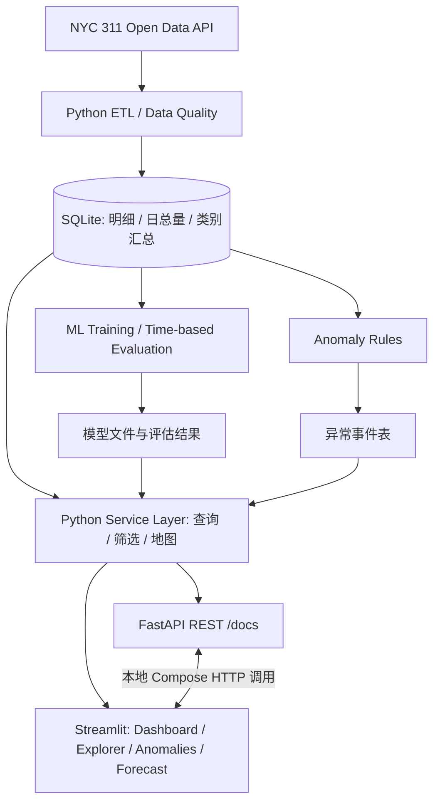

# CivicOS — AI-Powered Urban Intelligence Platform

> **四人团队 · 7 天 MVP · Python-first · Docker Compose · 纽约 311 公共服务数据**  
> **版本：v0.2 / 四模块精简版** · 更新日期：2026-11-10  
> 文档用途：团队统一规划、技术设计、任务分配、验收、GitHub 项目说明

## 0. 本次决策：砍掉人手模拟，做深四个功能

**最终第一版只做四项：**

1. **数据总览（Dashboard）**：纽约哪里、什么时候、哪类公共问题报告得最多？
2. **地图探索（Geospatial Explorer）**：这些报告在空间上分布在哪里？
3. **异常检测（Anomaly Detection）**：哪些区域/投诉类型在某一天显著高于历史水平？
4. **需求预测（Demand Forecasting）**：某个 Borough 未来 7 天可能有多少服务请求？

**删除：Resource Allocation Simulator / `/simulate` API / 人员配置算法 / Simulator 页面。** 原因是 311 投诉数量不能直接代表工时、技能要求和处理能力；缺少部门人力、处理时长和服务等级等数据时，给出“应派多少人”的结果缺乏可靠依据。**不以“增加一个页面”换取虚假的决策精度。**

将释放的开发时间投入一个更强的完整体验：

> **发现问题 → 解释趋势 → 一键定位 → 查看具体分布 → 了解未来需求。**
>
> 例：发现 **Brooklyn 某日的住宅噪音投诉异常增加** → 点击该异常的“在地图中查看” → 地图自动筛选**相同日期 + Borough + 投诉类别** → 查看公开坐标可用的请求点及空间聚集。

这就是 v0.2 的核心亮点：**跨页面筛选与异常下钻（cross-filtering + anomaly drill-down）**，而不是四张互不关联的展示页面。

---

## 1. 项目定位与验收目标

### 1.1 一句话定位

**CivicOS 是一个基于真实 NYC 311 开放数据的城市服务需求观察平台，结合 ETL、SQL、交互式地理分析、可解释异常检测和机器学习预测，并提供容器化本地运行与在线演示。**

它是**分析与研究工具**，不是市政府的实时调度系统，也不应把投诉数等同于真实事件数、已证实的问题数量或实际处理工作量。

### 1.2 想证明的能力

| 工程方向 | 可核查成果 |
| --- | --- |
| Software Engineering | 分层架构、类型与输入校验、REST API、测试、代码审查、CI |
| Data Engineering | 官方 API 数据采集、清洗、去重、持续日期聚合、SQL 索引、数据质量报告 |
| ML / Applied Statistics | 合理时间切分、简单基线、预测模型评估、异常检测规则与局限说明 |
| Product Engineering | 四页交互 UI、跨页面状态传递、趋势和地图联动、可用性与错误处理 |
| DevOps | Dockerfile、Docker Compose 双容器、可复现启动、GitHub Actions |

### 1.3 一周内的交付标准

本地一条命令尽量启动可演示系统；在线提供可打开的产品 Demo；四个功能都能使用真实或清晰标注的缓存快照数据；**至少一条“异常 → 精确条件地图”端到端路径可靠工作**；四位成员各自有可追踪的独立贡献。

*预计投入：每人约 25–35 小时，共约 100–140 人时。这是规划预算，不是交付保证。*

---

## 2. 技术栈与选型原则

根据现有 GitHub 个人简介，已经具备 Python、基础 SQL、pandas、NumPy、matplotlib、scikit-learn、Jupyter、Git/GitHub、模块化与基础测试经验。第一周以 Python 为核心，不引入非必要的大型新框架。

| 层级 | 技术 | 用途 |
| --- | --- | --- |
| 主要语言 | Python 3.11 | 统一服务、数据和模型代码 |
| ETL / 统计 | pandas、NumPy | 数据清洗、日级特征、规则计算 |
| 存储 | SQLite + SQL | 明细记录、历史每日聚合、查询索引 |
| ML | scikit-learn | 未来 7 天需求预测及回测 |
| 交互图表/地图 | Plotly + Streamlit | 趋势、类别图、地图、跨页导航 |
| API | FastAPI + Pydantic + Uvicorn | 查询端点、参数校验、`/docs` |
| 测试 | pytest | 数据、统计、API、跨页筛选逻辑 |
| 代码质量 / CI | GitHub PR + GitHub Actions | 协作、自动检查与镜像构建 |
| 容器化 | Docker + Docker Compose | 前后端双服务与数据卷 |
| 在线演示 | Streamlit Community Cloud | 不依赖完整 Compose 的公开 Demo |

**刻意不使用：** Kubernetes、Kafka、Spark、Redis、复杂深度学习框架，以及为炫技而增加的微服务拆分。PostgreSQL、完整云端容器托管在后续阶段再评估。

---

## 3. 四个功能如何组成一条用户流程

### 3.1 Dashboard — 数据总览

**回答：** 纽约目前选定历史窗口里，投诉量多少、主要来自哪类问题、哪个 Borough、怎样随时间变化？

P0 内容：

- 统计卡片：请求数、覆盖日期、数据更新时间；可增加各区排名与类别 Top N。
- 交互趋势图：按日请求量；支持时间范围、Borough、投诉类别筛选。
- 类别柱状图/区域对比图；明确图表所用统计口径和日期范围。
- 高亮异常日期，让用户顺势查看发生了什么。

注意：不要把抽样明细的条数当作全市实际请求量；总览的“真实日总量”使用相应范围的完整聚合数据。

### 3.2 Geospatial Explorer — 地图探索

**回答：** 选择的日期和类型的投诉具体集中在哪里？

P0 内容：

- 过滤条件：`date`、`borough`、`complaint_type`，所有入口使用同一套枚举/日期格式。
- 显示具有有效公开经纬度的请求点；点过多时限制点数、聚合或采样，并明显提示展示策略。
- 展示匹配记录数、具有坐标的记录数和地图实际绘制点数，避免三者混淆。
- 提供从异常页跳转后的可见筛选条件，用户可以继续修改。

**“街区”表达需要谨慎：** 如果只有点坐标而无正式街区边界，只说“空间聚集”或“附近区域”，不擅自给点簇命名为行政街区。没有坐标的投诉依然计入对应的统计表，但不出现在点地图上。

### 3.3 Anomaly Detection — 异常检测

**回答：** 哪个 Borough、哪一类投诉、哪一天偏离了过去的正常水平？

P0 内容：

- 输出异常 `date + borough + complaint_type + observed + expected + severity`。
- 基于历史滚动统计或同星期参考分布构建可解释规则，展示阈值与对照信息。
- 列表可按异常程度排序；每条记录有 **“在地图中查看”** 入口。
- 对检测窗口、低样本量、历史节假日波动、缺失天数作出提示。

**核心交互：** 选择异常后，系统将精确筛选条件传给地图探索页。异常来自按类别聚合数据，但地图必须使用与该事件日期/区域/类型相匹配的请求明细。不得把不同时间范围的数据拼接成“似乎对应”的热点图。

### 3.4 Demand Forecasting — 需求预测

**回答：** Brooklyn、Queens 等 Borough 下周大概还会有多少服务请求？

P0 内容：

- 选择 Borough，查看未来 7 天**预计总请求量**（预测粒度与模型训练目标一致）。
- 显示历史趋势、预测截止日期、模型名称和测试误差。
- 与简单的历史基线对比；没有优于基线就如实说明。
- 不把“未来七天总量预测”包装成已实现的“每日精确预测曲线”。如确实训练了逐日模型，可增加按日预测展示。

---

## 4. 数据来源与最重要的数据一致性设计

### 4.1 数据源

- **主要：** [NYC Open Data](https://data.cityofnewyork.us/) 的 NYC 311 Service Requests 数据；使用官方数据入口与 [Socrata API 文档](https://dev.socrata.com/) 核对当前数据集 ID、字段、访问限制及更新时间。
- **非 MVP 必需：** [Open-Meteo](https://open-meteo.com/) 历史天气；天气相关性探索推迟。
- **后续：** [Edmonton Open Data](https://data.edmonton.ca/) 多城市适配。

*以上是来源与计划，具体记录总量、可用字段与 API 限流需以开发时实际检查为准。*

### 4.2 两层数据，不能混用统计口径

| 数据层 | 建议范围 | 作用 | 重要限制 |
| --- | --- | --- | --- |
| `daily_demand`：每日 Borough 总量 | 连续 12–24 个月 | 历史趋势、未来 7 天预测 | 必须来自完整、可靠的时间区间汇总 |
| `daily_category_counts`：日期 × 区 × 类别 | 覆盖异常检测用的历史窗口 | 异常检测与类别趋势 | 注意类别命名变化、缺失日补零规则 |
| `service_requests`：有日期及坐标的记录明细 | 近期有界窗口，或已缓存的异常样例 | 地图精确下钻、详情 | 不能把局部样本当作全市完整总量 |

**必须解决“点击异常后有图可看”的覆盖关系：**

1. 异常检测从 `daily_category_counts` 计算，但只有在地图具备相同 `date + borough + complaint_type` 的明细时，才展示“可直接下钻”。
2. **首选方案：** 本地缓存一个连续近期窗口内的目标类别明细，异常列表优先展示这段时间的事件。
3. **备选方案：** 由后端按异常条件向官方 API 做有界查询并缓存；为离线 Demo 至少预置 2–3 个真实可复现事件的明细快照。
4. 不能提供明细时显示“此日期没有可用的地图明细 / 坐标数据”，而不是展示其他日期的点。
5. 如果每次地图最多绘制 N 个点，明示“绘制 N / 符合条件 M / 有效坐标 K”，并说明是采样还是聚合。

第一周挑战目标可以是 **10 万条以上真实明细（若数据访问允许）**，但不能以追求数据条数牺牲时间完整性与下钻正确性。尤其不能从多年记录中随机抽 10 万条，再将每日抽样条数作为总需求来训练模型。

### 4.3 ETL 任务与质量检查

1. Extract：官方 API 有界查询、分页、请求失败重试与缓存。
2. Validate：唯一 ID、创建日期、类别、Borough、坐标合法性。
3. Transform：标准化时区/日期、分类字段、空值、状态、重复记录。
4. Aggregate：按日期、Borough 以及类别生成历史时间序列。
5. Load：SQLite 幂等写入、建立必要索引。
6. Audit：记录数据截止时间、来源、行数、重复率、覆盖日期、缺失坐标比例。

时间统一使用**纽约当地日历日期**定义每日桶，并在 `docs/data_dictionary.md` 写明时区与跨日口径。API 若提供原始时间格式，要在聚合前统一，不能跨页面各自截取日期。

---

## 5. 重点体验：异常 → 精确地图下钻

### 5.1 用户故事

> 作为浏览 NYC 311 数据的人，我在趋势图或异常列表看到某天 Brooklyn 的住宅噪音投诉数量升高。我点击“在地图中查看”，希望立刻看到**同一天、同一区、同一投诉类别**的公开请求点，理解空间分布，而不是重新选择三次筛选器。

### 5.2 必须统一的筛选状态

```json
{
  "date": "2026-10-15",
  "borough": "BROOKLYN",
  "complaint_type": "Noise - Residential"
}
```

以上日期和类别仅用于说明传参格式，不代表已确认的真实异常事件。

**前后端统一合约：**

- `date`：`YYYY-MM-DD`（纽约当地日期）。
- `borough`：数据库定义的标准枚举（例如 `BROOKLYN`）。
- `complaint_type`：与源数据规范化后的分类名称严格一致；禁止在前端只传模糊关键词。
- 无结果不静默清除条件，应保留筛选器并解释“匹配数据 0 条”。

### 5.3 实现路线（先保证稳定，再追求炫酷）

**P0（第一周必须完成）**：趋势图标记异常日期；异常列表每行提供“在地图中查看”按钮。点击时将参数写入 Streamlit Session State 或 URL Query Parameters，然后切换到 `Explorer` 页面；地图自动读取并应用这三个条件。

**P1（时间允许才做）**：直接点击 Plotly 趋势图中的单个点，自动填入同样的筛选状态。原生 Streamlit 图表事件能力与版本相关，不能未经验证就把“任意点单击回调”当作现成功能；必要时通过已测试的组件实现，并保留 P0 按钮作为可靠路径。

### 5.4 交互验收案例

```text
[异常列表 / 趋势高亮]
  BROOKLYN · Noise - Residential · 2026-10-15
                 │
                 └── 点击「在地图中查看」
                             ↓
[Geospatial Explorer]
  date = 2026-10-15
  borough = BROOKLYN
  complaint_type = Noise - Residential
                             ↓
  展示匹配数 / 有效坐标数 / 实际点数
  显示地图；条件可继续调整；一键返回异常列表
```

**通过标准：** 一次点击后三个条件全部正确；地图与列表数据口径一致；无坐标/无数据有明确反馈；刷新或跨页后状态不会产生不受控错乱。

---

## 6. 系统架构与职责边界



### 为什么保留两个应用？

- **Streamlit**：面向用户，负责四个页面、趋势选择、地图与异常下钻。
- **FastAPI**：面向开发者和前端调用，负责结构化 JSON 响应、参数验证与 Swagger 文档。
- **共享业务层**：数据库查询、异常筛选、预测推理只能有一份核心实现，避免 API 和 Streamlit 分别写一套而输出不一致。

**本地模式：** Streamlit → `http://api:8000` → Python 服务层 → SQLite。  
**在线 Demo 模式：** Streamlit Community Cloud 可以直接调用同仓库服务层与发布的缓存快照，不依赖另一台在线 FastAPI。两种模式应通过配置切换，界面使用同一结果结构。

---

## 7. 数据库与 REST API 合约

### 7.1 SQLite 表

| 表 | 字段（示例） | 作用 |
| --- | --- | --- |
| `service_requests` | `unique_key`, `created_date`, `local_date`, `borough`, `complaint_type`, `latitude`, `longitude`, `status` | 有界明细和地图 |
| `daily_demand` | `date`, `borough`, `request_count` | 预测和总量趋势 |
| `daily_category_counts` | `date`, `borough`, `complaint_type`, `request_count` | 类别趋势与异常计算 |
| `anomaly_events`（可缓存） | `event_id`, `date`, `borough`, `complaint_type`, `observed`, `expected`, `severity` | 可点击异常事件 |
| `data_metadata` | `source`, `snapshot_at`, `min_date`, `max_date`, `row_count` | 质量与更新时间 |

重要索引：`(local_date, borough, complaint_type)` 用于地图下钻；`(date, borough)` 用于总量趋势；`(date, borough, complaint_type)` 用于类别趋势。可以按查询实际表现调整。

### 7.2 六个核心 API（取代旧版的 `/simulate`）

| 方法 | Endpoint | 用途 |
| --- | --- | --- |
| GET | `/health` | 服务健康检查 |
| GET | `/summary` | 统计总览指标 |
| GET | `/trends` | 带筛选的时间趋势 |
| GET | `/anomalies` | 可解释异常事件列表 |
| GET | `/forecast` | 未来七天总量预测、基线与评估指标 |
| GET | `/map/requests` | 按日期、Borough、类别提取公开地图明细/坐标 |

**核心下钻 API 示例：**

```http
GET /map/requests?date=2026-10-15&borough=BROOKLYN&complaint_type=Noise%20-%20Residential&limit=2000
```

**响应结构示例（示意值，非真实数据）：**

```json
{
  "filters": {
    "date": "2026-10-15",
    "borough": "BROOKLYN",
    "complaint_type": "Noise - Residential"
  },
  "matching_records": 142,
  "geocoded_records": 129,
  "displayed_points": 129,
  "sampled": false,
  "points": [
    {"id": "example-id", "latitude": 40.68, "longitude": -73.97}
  ],
  "snapshot_at": "2026-10-16T00:00:00Z"
}
```

**API 约束：** 参数类型与允许值校验、分页/数量限制、标准错误响应、空结果明确返回、跨表日期一致性；不能向客户端一次性返回几十万条点位。示例中的坐标和统计仅用于说明数据格式。

---

## 8. ML 与异常检测：方法必须经得起提问

### 8.1 预测任务定义

**预测目标：** 对一个 Borough，预测**未来 7 个自然日的请求总量**。优先采用一个直接预测“未来七日总和”的模型，降低第一周递归预测的复杂度。

- 输入特征：历史 1/7/14 天数量、过去一周均值和变化、星期/月份、Borough 等；**全部特征必须在预测截止时已知**。
- Baseline：最近 7 天总量、或历史同星期规律；选一种明确实现并保存结果。
- ML：`RandomForestRegressor` 或 `HistGradientBoostingRegressor`，从一个模型开始。
- 评估：时间顺序切分 / 滚动回测，至少报告 MAE；如有 WAPE，注意零分母情形。
- 展示：预测的 **7 日总量、数据截止日期、回测 MAE、基线 MAE**。若模型不优于基线，UI 诚实显示。

不可在特征中使用未来 7 天实际请求量或未来观测天气。必要时解释日期边界、历史缺失天处理及模型误差。

### 8.2 异常规则

第一版优先选择**可解释**的规则：例如对同一 Borough + 投诉类型，根据之前若干周的同星期历史值计算参考均值和波动阈值。输出观察值、参考值、偏离幅度与级别。

要考虑：低频类别的偶发跳动、长期季节趋势、历史窗口太短、零方差、少量重复报警、近期数据回填。所有异常必须是**基于已确认的历史数据**而非“系统实时报警”。

### 8.3 预测和异常检测的分工

- 预测用于“**接下来**大概多少”，可以在一个 Borough 的汇总层面进行。
- 异常用于“**过去哪天**哪里哪类问题突然增多”，需要 `date + borough + complaint_type` 细粒度。
- 地图进一步回答该异常“**具体分布在哪些位置**”，使用同条件的记录明细。

**不要为了形式上的统一，强制让一个预测模型承担异常检测和地理解释两种不同任务。**

---

## 9. Docker / Docker Compose 实施方案

### 9.1 为什么值得用 Docker

统一四个人的 Python 依赖和服务启动方式；容器网络连接前后端；SQLite 数据通过本地目录持久化；CI 可以验证镜像；面试可解释镜像、容器、端口、卷与服务发现。

### 9.2 Dockerfile（基本骨架）

```dockerfile
FROM python:3.11-slim
WORKDIR /app
COPY requirements.txt .
RUN pip install --no-cache-dir -r requirements.txt
COPY . .
EXPOSE 8000 8501
```

### 9.3 compose.yaml（双容器最小示例）

```yaml
services:
  api:
    build: .
    command: uvicorn api.main:app --host 0.0.0.0 --port 8000
    ports:
      - "8000:8000"
    volumes:
      - ./data:/app/data

  frontend:
    build: .
    command: streamlit run app/streamlit_app.py --server.address 0.0.0.0 --server.port 8501
    ports:
      - "8501:8501"
    environment:
      API_BASE_URL: http://api:8000
    depends_on:
      - api
```

```bash
docker compose up --build     # 本地启动
docker compose ps             # 查看状态
docker compose logs -f        # 查看日志
docker compose down           # 停止服务
```

- 浏览器访问：`http://localhost:8501`（UI）与 `http://localhost:8000/docs`（API 文档）。
- **容器内部**的前端使用 `http://api:8000`，不能用 `localhost:8000` 访问另一个容器。
- `depends_on` 只控制启动顺序，不保证服务已经准备好。联调时加重试或健康检查。
- `./data:/app/data` 持久化 SQLite，路径须在应用配置中保持一致。
- 这是一份**配置骨架**：仓库必须实际提供 `requirements.txt`、入口文件、数据库初始化/示例数据与模型文件，才能成功启动。
- 若要真正做到**首次运行一条命令**，API 启动时需检测数据是否存在，并从仓库的小型合法快照自动初始化；首次采集完整数据另设明确命令。

### 9.4 .dockerignore 建议

```gitignore
.git
.venv
__pycache__/
.pytest_cache/
.env
*.pyc
.ipynb_checkpoints/
data/raw/
data/*.db
```

不要提交大数据、账号密钥或不必要的生成文件；依赖版本尽量固定。Streamlit Community Cloud **不会运行整套 Docker Compose**；线上采用 Streamlit + 共享 Python 业务层的独立演示模式。

---

## 10. 四人分工（按更新后的四模块调整）

目前只掌握一位成员的技术简介，暂按四人 Python 能力接近分工；每个人都应有独立可见的交付成果。

| 成员 | 核心角色 | 负责模块与交付 | 协作接口 |
| --- | --- | --- | --- |
| **A** | Data Engineer | NYC API 采集、SQL 表、日期/类别聚合、明细缓存、覆盖范围与质量报告 | 向 B 提供可靠汇总，向 C 提供可下钻明细 |
| **B** | ML & Anomaly Engineer | Baseline、七日预测、回测报告、异常规则、异常事件结构 | 向 C 交付统一 `forecast` / `anomalies` 结果 |
| **C** | Backend & DevOps Engineer | 六个 API、输入校验、`/map/requests`、测试、Docker、GitHub Actions | 保证下钻筛选和业务服务层一致 |
| **D** | Frontend & Product Engineer | 四个 Streamlit 页面、图表、地图、异常事件跳转、公开 Demo | 负责跨页状态、交互稳定性和演示流程 |

**最重要的双人联调：B + D**（异常事件点击）以及 **A + C**（给定条件能够获得对应明细）；C + D 确保接口与 UI 一致。原本负责模拟器的时间转为下钻 API、测试、错误处理与部署质量。

### GitHub 协作约定

- 仓库 `CivicOS`，`main` 为稳定分支，四个功能分支：`feature/data-pipeline`、`feature/ml-anomalies`、`feature/api-docker`、`feature/interactive-ui`。
- Pull Request 合并；尽量由至少一位其他成员 Review；GitHub Issues 写清可验证的 Done 标准。
- **Day 1 锁定**字段、日期口径、API JSON 结构、异常传参格式；修改合约必须在团队里同步。
- 每天至少一次集成，不把四个模块留到最后一天才合并。

---

## 11. 七天冲刺排期

| 日期 | 团队目标 | A：数据 | B：预测/异常 | C：后端/Docker | D：前端 |
| --- | --- | --- | --- | --- | --- |
| **Day 1** | 定范围、搭仓库、锁接口 | 检查数据字段/日期口径 | 选预测目标、异常规则 | `/health`、共享数据 Schema | 四页导航骨架、联动原型 |
| **Day 2** | 首次真实数据落地 | 明细采集、每日聚合、SQLite | Baseline 与异常输入表 | Dockerfile + Compose、读库层 | Dashboard 使用真实汇总 |
| **Day 3** | 趋势 + 地图可看 | 类别聚合、坐标质量审计 | 历史基线、时间切分 | `/summary` `/trends` `/map/requests` | 趋势图、地图过滤器 |
| **Day 4** | 异常可以点击下钻 | 为演示异常补齐明细缓存 | 异常检测、预测模型初版 | `/anomalies` `/forecast` | 异常列表 → 地图状态传递 |
| **Day 5** | 四模块完整联动 | 对齐图表/地图数据覆盖 | 模型回测、异常阈值调整 | API 参数与边界案例测试 | 四页整合、交互提示与样式 |
| **Day 6** | 稳定化与上线 | 可复现样本/数据字典 | 模型评估报告 | pytest、GitHub Actions、Docker 构建 | Streamlit Cloud、Bug 修复 |
| **Day 7** | 发布 + 演示 | 数据来源/质量说明 | 指标真实性说明 | API/Docker 文档、Release 验证 | 截图、2–3 分钟 Demo 视频 |

**Day 4 硬规则：** 如果“从一条真实异常事件点击到正确地图”仍不成立，暂停新图表、天气、花哨样式和额外模型，集中解决端到端路径。

### 各日完成门槛

- Day 1：四人能启动最小 UI/API；表结构、接口合约和筛选状态统一。
- Day 2：至少能从真实数据构建日期聚合并展示；Docker 双服务骨架可启动。
- Day 3：趋势与地图都按同一套条件筛选，且不混淆聚合与抽样。
- Day 4：有一条可演示的真实异常，**点击后**地图显示相同 `date + borough + complaint_type`。
- Day 5：四个页面与六个 API 至少达到功能可用。
- Day 6：测试通过、构建成功、在线 Demo 能打开。
- Day 7：文档、截图、演示视频、可运行 Release；达不到的不宣称完成。

---

## 12. P0、P1、明确不做与验收

### 12.1 第一周 P0（必做）

- [ ] 可重复运行 ETL；SQLite 包含日期汇总、类别汇总及有界明细。
- [ ] Dashboard：真实统计、趋势、类别与 Borough 筛选。
- [ ] Explorer：按日期/区域/类型筛选地图，并显示坐标覆盖情况。
- [ ] Anomalies：可解释结果、历史参照、事件下钻入口。
- [ ] **异常事件 → 地图**：一次点击正确传递三个筛选条件。
- [ ] Forecast：未来七日总量、Baseline 对比和真实回测 MAE。
- [ ] FastAPI 六个核心接口、pytest、GitHub Actions。
- [ ] Docker Compose 启动前后端、SQLite 持久化；公开 Demo 可访问。
- [ ] README、架构图、数据字典、模型报告、演示视频。

### 12.2 P1（时间充足再做）

- 直接单击趋势图某一数据点触发下钻（不只点异常列表按钮）。
- 更高级的地图点聚合、区域边界、导出分析结果。
- 天气与城市投诉相关性的解释性分析；更系统的滚动回测。

### 12.3 不进入 v0.2

- **人手配置模拟器**、排班优化与工作人员产能推算。
- 用投诉数量推断工时或实际部门资源需求。
- Kubernetes、Kafka、Spark、实时流架构、复杂模型堆砌。
- 多城市即时兼容、完整云端双容器部署（第二阶段再做）。

### 12.4 挑战性验收指标（不是已完成成绩）

| 类别 | 目标 |
| --- | --- |
| 页面 | **4** 个完整的交互页面 |
| API | **6** 个核心接口（含地图请求查询） |
| 数据 | 连续约 **12–24 个月**可靠每日聚合；尽量处理 **100K+** 真实明细，但以覆盖与质量优先 |
| 链路 | **至少 2–3 个**可复现异常事件能跳到对应地图 |
| ML | **1** 份含时间切分、Baseline 与 MAE 的报告 |
| 测试 | **12+** 个有效自动化测试，优先覆盖下钻、时间序列及 ETL |
| Docker | `docker compose up --build` 可运行双服务（具备演示数据初始化） |
| 对外展示 | **1** 个公开 Demo + **1** 个 2–3 分钟演示视频 |

### 12.5 测试重点

1. ETL 重复运行不产生重复记录；同一日期/区域/类别的聚合正确。
2. 模型训练/回测中没有未来信息泄漏；预测范围始终为七日总量。
3. 异常事件转换为地图筛选器时，日期/区域/类别**完全一致**。
4. 地图请求只返回目标日期和目标类型，且点数受限制。
5. 没有匹配记录、没有有效坐标、跨日边界、未知类别等情况有明确结果。
6. 容器之间通过服务名通信；首次初始化后能启动；离线快照可用于演示。

---

## 13. 推荐仓库结构（已移除模拟器）

```text
CivicOS/
├── app/
│   ├── streamlit_app.py
│   └── pages/
│       ├── 1_Dashboard.py
│       ├── 2_Explorer.py
│       ├── 3_Anomalies.py
│       └── 4_Forecast.py
├── api/
│   ├── main.py
│   ├── routes/
│   └── schemas.py
├── src/
│   ├── data/
│   │   ├── collector.py
│   │   ├── cleaner.py
│   │   └── database.py
│   ├── ml/
│   │   ├── features.py
│   │   ├── train.py
│   │   ├── predict.py
│   │   └── anomaly.py
│   └── services/
│       ├── analytics.py
│       ├── geo.py
│       └── filters.py
├── tests/
│   ├── test_etl.py
│   ├── test_api.py
│   ├── test_anomaly_drilldown.py
│   └── test_forecast.py
├── notebooks/
├── scripts/
│   ├── ingest.py
│   └── bootstrap_demo.py
├── data/
│   └── sample/
├── models/
├── docs/
│   ├── architecture.md
│   ├── data_dictionary.md
│   ├── model_evaluation.md
│   └── project_plan.md
├── .github/workflows/ci.yml
├── .dockerignore
├── Dockerfile
├── compose.yaml
├── requirements.txt
├── .gitignore
└── README.md
```

命名为示例；最终 Python 模块结构与 Streamlit 页面跳转方式要经过实际运行测试。注意 `app/pages/` 目录内不要再包含 `simulator.py`，`src/services/` 内也不应保留 `simulation.py`。

---

## 14. 部署、Demo、README 与简历

### 14.1 两种演示模式

**本地工程演示：** `docker compose up --build` 启动 UI + API；重点展示两个容器、服务互联、`/docs`、数据持久化与 CI。  
**公开产品演示：** Streamlit Community Cloud 使用同一数据服务逻辑/缓存快照，重点展示真实可交互的四个页面；不要宣称云端在运行 Compose。

开发阶段准备一份覆盖 2–3 个确定异常事件的**可复现公开数据快照**，以免演示时 API 延迟、断网或数据更新导致热点消失。

### 14.2 2–3 分钟演示脚本（更新版）

1. **Dashboard（0:00–0:30）**：展示真实请求统计与 Brooklyn 的历史投诉趋势。
2. **Anomalies（0:30–1:00）**：展示某天某类别的异常观察值、历史基线与异常程度。
3. **关键时刻（1:00–1:30）**：点击 **“在地图中查看”**；Explorer 自动带入**同一天、同一区、同一投诉类别**，显示地图点位及坐标覆盖说明。
4. **Forecast（1:30–2:00）**：切换到未来七日总量预测，展示与 Baseline 的真实误差对比。
5. **工程收尾（2:00–2:30）**：快速展示 FastAPI `/docs`、Docker Compose、一条通过的 GitHub Actions workflow、团队 PR。

**演示优先级：** 准确的异常 → 地图下钻 > 多一张漂亮图 > 多一个未经验证的 ML 指标。

### 14.3 README 必备内容

- 项目是什么、解决什么问题、四模块截图/GIF。
- 数据来源、数据截止时间、抽样/地理覆盖限制。
- 架构图、技术栈与一键启动步骤。
- 模型预测目标、基线与真实回测结果。
- Docker、本地与在线演示运行模式的区别。
- 测试方法、CI 状态、贡献者与各人责任。
- 当前已实现、未完成、后续 Roadmap（不夸大）。

### 14.4 简历表述（完工后再据实使用）

**项目名：** `CivicOS | AI-Powered Urban Intelligence Platform`  
**技术栈：** `Python · FastAPI · Streamlit · SQLite · pandas · NumPy · scikit-learn · Plotly · Docker Compose · pytest · GitHub Actions`

**英文项目概述：**

> An end-to-end civic analytics platform integrating NYC 311 open-data ETL, SQL analytics, interactive geospatial exploration, explainable anomaly detection, seven-day demand forecasting, and cross-page anomaly-to-map drill-down.

| 成员 | 可以强调的贡献（交付后再写成过去式） |
| --- | --- |
| A | Reproducible ETL, validation, historical aggregates, spatial drill-down data coverage |
| B | Time-aware forecasting, baseline comparisons, explainable category-level anomalies |
| C | Validated REST APIs, Docker multi-service setup, automated testing and CI |
| D | Four-page interactive UI, anomaly-to-map cross-filtering, live demo deployment |

具体数字（处理行数、模型 MAE、测试通过数量、延迟改善）只使用你们**实测**的结果。

---

## 15. 风险、后续升级与参考资料

| 风险 | 应对 |
| --- | --- |
| 异常事件无法在地图中找到对应明细 | 限定可下钻的日期窗口，提前缓存真实事件；不展示错误日期的点 |
| 坐标缺失或来源地理精度有限 | 标注覆盖率，仅对有效公开点画图 |
| 训练时间序列由抽样记录误算而来 | 使用连续时间窗口的完整 API 聚合，不用抽样明细推总量 |
| 模型没比 Baseline 好 | 如实展示并允许使用 Baseline，不制造“准确率 95%” |
| API 数据变化或请求限流 | 有界请求、缓存、离线样本、保留来源与快照时间 |
| Docker 启动时数据文件不存在 | 启动前提供可重复执行的 demo 初始化脚本 |
| 前后端/页面筛选状态不一致 | Day 1 定接口，写下钻集成测试，Day 4 重点联调 |
| 开发时间不足 | 冻结 P1，保障四页面 + 一条完整关键链路 |

**未来确有部门人力/处理时长/服务等级数据时**，才考虑进一步研究人员配置与工作量估计；届时需要独立建模、验证和明确业务约束，不直接复活旧版基于随意参数的人手模拟器。

其他第二阶段方向：Edmonton 多城市适配、天气相关性、更丰富的历史滚动回测、地图聚合优化、完整容器云端部署。

**官方参考：**

- [NYC Open Data](https://data.cityofnewyork.us/)
- [Socrata Open Data API](https://dev.socrata.com/)
- [Streamlit](https://docs.streamlit.io/)
- [Streamlit Community Cloud](https://docs.streamlit.io/deploy/streamlit-community-cloud)
- [FastAPI](https://fastapi.tiangolo.com/)
- [scikit-learn](https://scikit-learn.org/stable/)
- [Docker Compose](https://docs.docker.com/compose/gettingstarted/)
- [GitHub Actions](https://docs.github.com/en/actions)
- [pytest](https://docs.pytest.org/)

---

## 16. 第一天立即执行的四个动作

1. **创建仓库 `CivicOS`**，将本文件放在 `docs/project_plan.md`，在 Issues 中建立 A/B/C/D 四条工作线。
2. **确认真实数据集和字段**：尤其是创建日期、Borough、投诉类别、坐标，以及可查询的历史汇总窗口。
3. **锁定六个 API 与筛选参数**：`date + borough + complaint_type` 是第一周最重要的跨模块契约。
4. **实现端到端最小纵切片**：哪怕先用明确标注的测试数据，也要做到“异常事件按钮 → Explorer 带筛选 → 地图点”运行一次，再逐步替换为真实快照。

> **最终原则：** 四个彼此连起来、数据口径正确、能解释方法且可复现的功能，胜过五个相互割裂、依赖随意假设的页面。CivicOS v0.2 以**可信数据 + 精准下钻 + 严谨预测 + 工程完成度**作为简历亮点。
