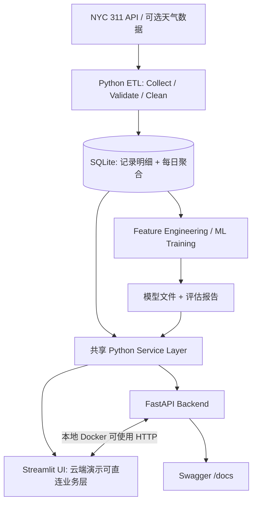

# CivicOS — AI-Powered Urban Intelligence Platform

> **四人团队 · 七天 MVP 冲刺 · Python-first · Docker 化的城市级数据智能平台**  
> 项目中文名：**CivicOS：城市公共服务智能分析与决策平台**  
> 文档类型：项目立项书 / 技术设计 / 开发计划 / 演示与简历指南  
> 版本：`v0.1`（规划稿） · 编写日期：2026-11-09

---

## 目录

1. [项目目标与定位](#1-项目目标与定位)
2. [现有技术基础与选型](#2-现有技术基础与选型)
3. [产品场景与五大功能模块](#3-产品场景与五大功能模块)
4. [真实数据与处理策略](#4-真实数据与处理策略)
5. [系统架构与核心设计](#5-系统架构与核心设计)
6. [机器学习、异常检测与模拟器](#6-机器学习异常检测与模拟器)
7. [数据库与 API 设计](#7-数据库与-api-设计)
8. [Docker 与 Docker Compose](#8-docker-与-docker-compose)
9. [团队分工与 Git 协作](#9-团队分工与-git-协作)
10. [七天开发计划](#10-七天开发计划)
11. [MVP 范围、验收标准与风险](#11-mvp-范围验收标准与风险)
12. [项目目录结构](#12-项目目录结构)
13. [部署、文档与演示方案](#13-部署文档与演示方案)
14. [简历与面试展示](#14-简历与面试展示)
15. [后续扩展与参考资料](#15-后续扩展与参考资料)

---

## 1. 项目目标与定位

### 1.1 为什么做这个项目

四名计算机科学本科生希望在**一周内共同构建一个体量足够大、技术含量足够高、可放进未来实习简历的团队项目**。目标不是展示技术名词的数量，而是建立一个完整、可运行、可演示、能够解释工程权衡的产品。

重点证明四类能力：

- **Software Engineering**：项目结构、模块化、后端 API、测试、代码审查、CI、容器化。
- **Data Engineering**：真实公开数据采集、清洗、去重、SQL 存储、按日聚合。
- **Machine Learning**：时序特征工程、需求预测、基线比较、回测和异常检测。
- **Product Engineering**：可交互 Dashboard、地理可视化、可解释预测、在线 Demo。

不建议做普通聊天机器人、Todo List、简单管理系统或仅包含 Notebook 的预测项目。这些题目不容易完整展示四个人的独立贡献。

### 1.2 产品一句话介绍

**CivicOS 是一个面向城市公共服务数据的交互式智能分析平台，将 NYC 311 服务请求的历史分析、地理探索、机器学习需求预测、异常检测和资源分配模拟连接成一个完整的决策流程。**

**核心演示路径：** 查看真实历史数据 → 定位区域问题 → 预测未来需求 → 发现异常 → 模拟资源配置。

### 1.3 第一周的成功定义

交付一个可在本地通过 `docker compose up --build` 启动、公开可演示、有测试、有 GitHub 项目文档、有四人明确贡献的 MVP。**不要把“项目体量大”误解为必须上 Kubernetes、Kafka、Spark 或 Transformer。**

---

## 2. 现有技术基础与选型

### 2.1 基于已提供的个人 GitHub README

现有简介覆盖的技能：

- **语言**：Python、C、基础 SQL、Markdown、基础 HTML。
- **数据与机器学习**：Jupyter Notebook、pandas、NumPy、matplotlib、scikit-learn 基础。
- **软件工具**：Git、GitHub、GitHub Desktop、PyCharm、VS Code。
- **工程概念**：函数、类与对象、文件读写、JSON、命令行程序、基础测试、模块拆分、代码重构。
- **已实践方向**：Python 音乐队列重构、阅读和改进小型开源 Python 项目。

因此采用 **Python-first** 路线，不为了炫技强行使用 C，也不要求四人临时掌握复杂前端框架。

### 2.2 推荐技术栈

| 层次 | 主要技术 | 作用 | 学习负担 |
| --- | --- | --- | --- |
| 核心语言 | Python 3.11 | 数据、模型、后端、前端主要逻辑 | 已有基础 |
| 数据处理 | pandas、NumPy | 清洗、聚合、特征工程 | 已有基础 |
| 数据库 | SQLite、SQL | 原始记录及统计数据持久化 | 基础拓展 |
| 模型 | scikit-learn | 需求预测、模型评估 | 已有基础 |
| 图表 / 地图 | Plotly、matplotlib | 交互图表、热力或散点地图 | 小幅拓展 |
| Web UI | Streamlit | 快速构建多页面交互式产品 | **新增重点** |
| 后端 | FastAPI、Pydantic、Uvicorn | REST API、请求验证、接口文档 | **新增重点** |
| 测试 | pytest | 单元测试、API 测试 | 小幅拓展 |
| 协作 / CI | Git、GitHub、GitHub Actions | Pull Request、代码审查、自动测试 | **新增重点** |
| 容器化 | Docker、Docker Compose | 统一环境、双服务编排、一键启动 | **新增重点** |
| 云端 Demo | Streamlit Community Cloud | 公开分享产品 | 小幅拓展 |

**克制原则：** 第一周不引入 PostgreSQL、Redis、Kafka、Spark、Kubernetes、微服务集群或复杂深度学习框架，除非 MVP 已经提前完成。

---

## 3. 产品场景与五大功能模块

### 3.1 Urban Intelligence Dashboard（城市运营总览）

- 全市服务请求数量、各日趋势、投诉类别排名。
- 各 Borough 请求量、关闭率、处理时长等指标（需正确处理仍未关闭的记录）。
- 时间范围、区域、投诉类别筛选。
- 图表联动和数据导出（有时间再做完整导出）。
- 关注数据更新时间，避免把历史数据当作实时数据。

**主要技术：** pandas、SQL、Streamlit、Plotly。

### 3.2 Geospatial Explorer（地理交互分析）

- 纽约五个 Borough 的投诉分布。
- 对具有有效公开坐标的记录显示地图散点或聚合热点。
- 点击区域后同步过滤投诉类别和时间序列。
- 大数据使用采样、聚合或预计算，避免一次向页面传输全部点位。

**主要技术：** SQL、Plotly / Streamlit 地图组件。

### 3.3 ML Demand Forecasting（需求预测）

- 以 Borough 为粒度预测**未来七天服务请求总量**。
- 显示历史数据、预测值、回测误差。
- 与“上周同期 / 历史移动平均”等简单基线比较。
- 明确展示模型是否真的优于基线；不虚构准确率。

**主要技术：** scikit-learn、pandas、NumPy。

### 3.4 Automated Anomaly Detection（异常检测）

- 识别某 Borough / 某投诉类别相对历史水平突然升高的情况。
- 展示异常时间、预期水平、观察值与偏离程度。
- 异常提醒可点击进入趋势或对应筛选结果。
- 先采用可解释的滚动统计方法，不强求复杂模型。

**主要技术：** pandas、统计规则 / 简单异常检测。

### 3.5 Resource Allocation Simulator（资源配置模拟）

- 用户输入可用工作人员总数、每人每天处理能力等参数。
- 根据预测请求量按区域分配人力，比较模拟积压量。
- 可以比较“平均分配”与“按需求比例分配”等策略。
- **必须标注：这是基于用户假设参数的 What-if 模拟，不是官方资源调度建议，也不声称获得真实政府人力数据。**

**主要技术：** Python、基础数学、业务服务层。

---

## 4. 真实数据与处理策略

### 4.1 核心数据源

1. **NYC Open Data — 311 Service Requests**：纽约市公开 311 服务请求数据。可用字段通常包括请求创建日期、类别、所属机构、状态、Borough、地理位置等；应在实施时针对所选数据集再次核对字段、数据量、更新时间和许可信息。
2. **Open-Meteo Historical Weather API（扩展功能）**：可用于探索天气与服务需求之间的相关关系，不是 MVP 必需条件。
3. **Edmonton 311（第二阶段）**：作为多城市数据适配目标；城市数据的地理精度和字段口径可能不同，需要独立适配。

官方入口：

- NYC Open Data：<https://data.cityofnewyork.us/>
- Socrata API 文档：<https://dev.socrata.com/>
- Open-Meteo：<https://open-meteo.com/>
- Edmonton Open Data：<https://data.edmonton.ca/>

### 4.2 不要随意下载全部历史数据

建议采取**双层数据策略**：

| 层级 | 建议范围 | 用途 |
| --- | --- | --- |
| **历史每日汇总表** | 连续约 12–24 个月，按日期和 Borough 聚合 | 机器学习、需求趋势和评估 |
| **请求明细样本** | 约 100,000–300,000 条（挑战目标） | 类别查询、详情、地图探索 |

重要说明：**不能从多年记录中随机抽 10 万条，然后把抽样后的“每日请求量”当作真实总量用于预测。** 这样会扭曲时间序列。用于预测的每日总量应来自完整日期范围的可靠聚合查询；抽样明细仅用于展示和局部探索。

### 4.3 ETL（Extract → Transform → Load）

1. **Extract**：通过官方 API 分页抓取或聚合查询，控制请求量，必要时缓存原始结果。
2. **Validate**：检查必填字段、时间类型、区域值、坐标合理性、唯一 ID。
3. **Transform**：统一时间格式、状态值和 Borough 名称，去重、处理缺失值。
4. **Aggregate**：构建每日总量表、按类别统计表等。
5. **Load**：写入 SQLite，创建查询索引。
6. **Quality Check**：记录行数、缺失率、重复率、日期覆盖范围及采集截止时间。

可复现交付：`python scripts/ingest.py` 或类似脚本，配合一个可离线启动的小型演示数据集。数据抓取失败时，Demo 不应完全不可用。

---

## 5. 系统架构与核心设计

### 5.1 总体架构



### 5.2 为什么同时有 Streamlit 和 FastAPI

- **Streamlit**：面向用户，做图表、地图、筛选和模拟。
- **FastAPI**：面向开发者，展示独立的 REST API、请求参数验证及自动生成的接口文档。
- **Service Layer**：两者共享查询和预测逻辑，避免相同业务规则实现两遍。

两种运行模式应提前约定：

1. **本地 Docker Compose 模式**：Streamlit 使用容器网络访问 `http://api:8000`；FastAPI 从共享服务层取数据。
2. **Streamlit Community Cloud 模式**：可以直接调用同仓库 Python Service Layer 或使用演示数据，避免额外托管 FastAPI 服务器。

这让系统既具备双服务容器化演示能力，也能在一周内更可靠地公开展示。

---

## 6. 机器学习、异常检测与模拟器

### 6.1 预测问题定义

**目标：** 对每个 Borough 预测接下来七天的服务请求总量。

可用特征：

- 最近 1、7、14 天的请求量（全部只能使用预测时点之前的数据）。
- 历史 7 天移动平均、趋势变化。
- 星期、月份、季节等时间特征。
- Borough 类别编码。
- 天气特征（选做；预测未来时要明确天气数据来源，不能偷用未来真实观测值）。

模型建议：

- **Baseline**：同星期历史均值、最近七日均值等。
- **ML Model**：`RandomForestRegressor` 或 `HistGradientBoostingRegressor`。
- **评估**：按时间划分训练集 / 验证集 / 测试集，至少计算 MAE；可加入 WAPE。
- **结果**：保存模型、数据截止时间、回测数据和评估指标；可加入区间展示，但不能将随意画的区间称作统计置信区间。

如使用迭代预测未来七天，后续日期使用先前预测值构造滞后特征，应在代码与报告中说明误差传播；也可以选择直接预测未来七日的总量，以降低实现难度。优先保证**方法正确、指标真实、结果可复现**。

### 6.2 异常检测

MVP 使用滚动均值 / 标准差或历史同星期分位数阈值，输出：

```json
{
  "borough": "BROOKLYN",
  "complaint_type": "Noise - Residential",
  "date": "2026-10-15",
  "observed": 142,
  "expected": 86,
  "severity": "high"
}
```

**上例仅为接口格式示意，不是真实检测结果。** 处理零方差、节假日变化、低频类别和异常重复报警等边界情况。

### 6.3 资源模拟器

输入：预测请求量、总工作人员人数、每人每天假设处理量、分配策略。  
输出：各区域分配人数、预计处理能力、预计未处理积压、不同策略比较。

简单演示算法：

1. 按各区预测需求占比计算初步人数；
2. 使用整数分配策略保证总人数不超出设定值；
3. 计算 `max(0, 预计需求 - 假设处理能力)`；
4. 展示分配策略与积压量对比。

不得将模拟结果描述为实际政府运营绩效或已验证的最优调度方案。

---

## 7. 数据库与 API 设计

### 7.1 建议的 SQLite 数据表

| 表名 | 主要字段 | 作用 |
| --- | --- | --- |
| `service_requests` | `unique_key`, `created_date`, `closed_date`, `complaint_type`, `status`, `borough`, `latitude`, `longitude` | 选定范围的明细记录 |
| `daily_demand` | `date`, `borough`, `request_count` | 连续历史每日总量，用于模型 |
| `daily_category_counts` | `date`, `borough`, `complaint_type`, `request_count` | 类别趋势 / 异常检测 |
| `data_metadata` | `snapshot_at`, `source`, `min_date`, `max_date`, `row_count` | 数据范围和新鲜度 |

建议对 `(created_date, borough)`、`(date, borough)` 和类别查询字段配置适当索引。不同表的字段可按实际源数据调整。

### 7.2 API 合约（第 1 天确定）

| 方法 | Endpoint | 作用 |
| --- | --- | --- |
| GET | `/health` | 健康检查 |
| GET | `/summary` | 核心统计指标 |
| GET | `/trends` | 时间、类别和区域趋势 |
| GET | `/forecast` | 七天预测、回测指标、模型版本 |
| GET | `/anomalies` | 异常事件列表 |
| POST | `/simulate` | 根据输入参数返回资源配置模拟 |

示例：

```http
GET /forecast?borough=BROOKLYN&horizon=7
```

```json
{
  "borough": "BROOKLYN",
  "horizon_days": 7,
  "predicted_total": 8500,
  "model": "random_forest",
  "data_through": "2026-10-31",
  "backtest_mae": 190.5
}
```

**示例中所有数值均为虚构样例，实施后需由真实模型输出替换。**

API 需统一错误响应、参数验证（如日期范围和可用 Borough）、字段类型与空结果处理。打开 `http://localhost:8000/docs` 可展示 FastAPI 自动生成的接口文档。

---

## 8. Docker 与 Docker Compose

### 8.1 为什么必须加入 Docker

Docker 对本项目的真实价值：

- 让 Mac / Windows 等不同开发环境使用统一的 Python 依赖和启动命令。
- 运行 **Streamlit 前端 + FastAPI 后端** 两个相互通信的容器。
- 通过 Volume 在容器重启后保留 SQLite 数据。
- 让 GitHub Actions 能验证镜像构建，提高工程可信度。
- 在 README 中提供清晰可复现的一键启动方式。

**一句话理解**：Docker 将应用与依赖打包为镜像，容器按统一方式运行；Docker Compose 用一个配置文件启动多个关联服务。

### 8.2 开发用 `Dockerfile`

在项目根目录创建：

```dockerfile
FROM python:3.11-slim

WORKDIR /app

COPY requirements.txt .
RUN pip install --no-cache-dir -r requirements.txt

COPY . .

EXPOSE 8000 8501
```

这个版本是**第一周足够使用的最小示例**。正式构建还应固定依赖版本、排除敏感文件和大数据、按需增加非 root 用户及健康检查。`EXPOSE` 只是文档化容器端口，实际映射由 Compose 的 `ports` 控制。

### 8.3 `compose.yaml`

在根目录创建：

```yaml
services:
  api:
    build: .
    command: uvicorn api.main:app --host 0.0.0.0 --port 8000
    ports:
      - "8000:8000"
    volumes:
      - ./data:/app/data

  frontend:
    build: .
    command: streamlit run app/streamlit_app.py --server.address 0.0.0.0 --server.port 8501
    ports:
      - "8501:8501"
    environment:
      API_BASE_URL: http://api:8000
    depends_on:
      - api
```

说明：

- `api` 和 `frontend` 是服务名称，Compose 会创建可互相发现的网络。
- 容器中的 Streamlit 访问 API，使用 `http://api:8000`，**不是 `http://localhost:8000`**。
- 浏览器访问前端为 `http://localhost:8501`，访问 Swagger 文档为 `http://localhost:8000/docs`。
- `./data:/app/data` 保证 SQLite 文件在主机目录持久化。首次运行前创建 `data/` 文件夹，并保证 SQLite 路径指向 `/app/data/...`。
- `depends_on` 只控制启动顺序，不保证 API 已经健康可用；实际代码应处理暂时连接失败或加健康检查。
- 若需要 Streamlit Community Cloud 部署，可让 UI 在缺少 `API_BASE_URL` 时直接调用共享业务层。

### 8.4 `.dockerignore` 建议

```gitignore
.git
.venv
__pycache__/
.pytest_cache/
.env
*.pyc
.ipynb_checkpoints/
data/raw/
data/*.db
```

如果后续引入机密 API Key，切勿写死在 Dockerfile 或 GitHub 仓库中。

### 8.5 常用命令

```bash
# 安装 Docker Desktop 后，在项目根目录执行
docker compose up --build

# 查看容器状态
docker compose ps

# 查看服务日志
docker compose logs -f

# 关闭服务（保留绑定到本机的 data 文件夹）
docker compose down
```

**注意：** 以上命令是计划中的使用方式，不代表项目代码已经实现或镜像已成功构建。

### 8.6 一周内的 Docker 工作计划

| 日期 | Docker 任务 | 负责人 |
| --- | --- | --- |
| Day 1 | 安装 Docker Desktop，理解 Image / Container / Dockerfile | 四人 |
| Day 2 | 添加 Dockerfile 和 Compose，启动双服务 | C |
| Day 3–5 | 使用一致的环境开发与集成 | 全员 |
| Day 6 | 在 GitHub Actions 中运行测试与镜像构建 | C |
| Day 7 | 验证 README 一键启动说明、录制容器演示 | 全员 |

### 8.7 部署边界

**Streamlit Community Cloud 不会直接运行你们的整个 Docker Compose**。因此：

- **本地完整系统**：Docker Compose，两个容器。
- **公开在线演示**：Streamlit Community Cloud，调用共享业务层或使用演示数据。
- **未来完整云部署**：再考虑容器托管服务部署 FastAPI 和前端。

第一周不做 Kubernetes。真正理解镜像、容器网络、持久化和 CI 比堆技术名词更有价值。

---

## 9. 团队分工与 Git 协作

目前只获得一位成员的技术简介，以下默认四人的 Python 基础接近；实际可再按擅长方向调整。

| 成员 | 角色 | 主要工作 | 独立交付成果 |
| --- | --- | --- | --- |
| **A** | Data Engineer | API 采集、验证清洗、去重、SQL Schema、每日聚合 | ETL 脚本、数据库表、数据质量报告 |
| **B** | ML Engineer | 特征工程、基线、预测模型、时间回测、异常检测 | 训练脚本、模型、评估报告、推理函数 |
| **C** | Backend & Infrastructure Engineer | FastAPI、Pydantic、模拟器服务层、pytest、CI、Docker | REST API、自动化测试、Compose、CI 工作流 |
| **D** | Frontend & Product Engineer | Streamlit 多页面、图表地图、交互、集成、Demo 部署 | 用户界面、部署链接、演示流程 |

**集成责任：** C 负责 API 契约与代码集成，D 负责端到端演示体验；A/B 在第 1 天签订模块输入输出约定。

### 9.1 GitHub 工作流

- 建立一个主仓库 `CivicOS`，使用 `main` 作为稳定分支。
- 功能分支示例：`feature/etl`、`feature/ml-forecast`、`feature/api-docker`、`feature/dashboard`。
- 通过 Pull Request 合并，每次由至少一位其他成员审阅。
- 尽早提交可运行骨架，避免第七天才集成。
- 配置 GitHub Actions：安装依赖 → 运行 pytest → 构建 Docker 镜像（可选容器启动测试）。
- 使用 Issues 或 Project Board 分配任务，记录完成标准与障碍。

**团队约定：** 每晚各用 10–15 分钟同步阻塞；变更 API 格式、数据字段、模型文件路径时必须通知全体。

---

## 10. 七天开发计划

预计每人约 **25–35 小时**，总计约 **100–140 人时**；这是规划预算，不是完成保证。

| 日期 | 当日主线 | A：数据 | B：ML | C：后端 / Docker | D：前端 |
| --- | --- | --- | --- | --- | --- |
| **Day 1** | 架构与接口契约 | 验证数据源 / Schema | 确定预测目标 / 指标 | FastAPI `/health`，仓库搭建 | Streamlit 首屏，UI 草图 |
| **Day 2** | 数据落地 | 采集、清洗、SQLite、每日汇总 | 读取聚合表 / 特征框架 | Dockerfile、Compose、数据库查询骨架 | Dashboard 真实数据接入 |
| **Day 3** | 分析与基线 | 索引和类别聚合 | Baseline、时间划分 | `/summary`、`/trends` | 趋势图、地图、筛选 |
| **Day 4** | 预测与异常 | 检查数据质量 / 支援 | ML 训练、回测、异常检测 | `/forecast`、`/anomalies` | 预测页、异常页 |
| **Day 5** | 端到端集成 | 数据快照 / 回退方案 | 接口和模型输出固定 | `/simulate`、联调 | 模拟器交互、整体样式 |
| **Day 6** | 测试与部署 | ETL 测试 / 数据说明 | 模型可复现 / 报告 | pytest、GitHub Actions、镜像构建 | Streamlit Cloud、Bug 修复 |
| **Day 7** | 发布与展示 | 数据文档 | 模型文档 | API / Docker 文档 | README 截图、Demo 视频 / 发布 |

### 每天最低完成条件

- **Day 1 结束：** 四人可克隆仓库；API 和 Streamlit 均能启动；数据 Schema / API 合约已定。
- **Day 2 结束：** 使用真实数据的数据库和图表可运行；Docker 本地启动可行。
- **Day 3 结束：** Dashboard + 地图 + ML 基线初步成形。
- **Day 4 结束：** 最核心的“分析 → 预测”链路能够实际演示。
- **Day 5 结束：** 五模块都至少有可用的第一版。
- **Day 6 结束：** 所有核心功能经过基本测试，云端 Demo 可打开。
- **Day 7 结束：** 文档、演示视频、GitHub Release `v1.0.0`（达标后再打）。

**硬规则：Day 4 还未跑通主链路，就立刻停止开发扩展功能，转为集成、修 Bug 和补测试。**

---

## 11. MVP 范围、验收标准与风险

### 11.1 必做 vs. 可推迟

| 优先级 | 工作 |
| --- | --- |
| **P0 必做** | 真实数据采集、清洗、SQLite 存储、可复现数据快照 |
| **P0 必做** | Dashboard、区域地图、筛选器 |
| **P0 必做** | 未来七日预测与简单基线对比 |
| **P0 必做** | 历史趋势异常检测 |
| **P0 必做** | 简单的 What-if 人力配置模拟 |
| **P0 必做** | FastAPI、pytest、GitHub Actions、Docker Compose、本地与在线演示 |
| **P1 选做** | 天气数据关联分析、数据导出增强、更多模型对比 |
| **P2 后续** | Edmonton 等第二城市支持、实时流、深度学习、完整容器云部署 |

### 11.2 挑战性验收指标（不是已经完成的结果）

| 指标 | 目标 |
| --- | --- |
| 明细数据 | 处理 **100K+** 条真实记录（依 API 性能和时间调整） |
| 历史序列 | 连续约 **12–24 个月**真实每日聚合数据 |
| 功能页面 | **5** 个可交互页面 |
| API | **6** 个核心端点 |
| 自动化测试 | **12+** 个有效测试（更重视覆盖关键逻辑） |
| 模型评估 | **1** 份包含 Baseline 对比的真实报告 |
| Docker | **1** 条命令启动双服务 |
| 交付 | **1** 个公开 Demo、**1** 个 2–3 分钟演示视频 |

### 11.3 风险与应对

| 风险 | 解决方案 |
| --- | --- |
| API 请求限流 / 网络失败 | 分页、缓存、可复现快照、离线小样本 |
| 数据采样导致预测偏差 | 预测使用连续日期的真实每日聚合，明细采样只用于展示 |
| 前端和后端接口不匹配 | 第一天锁定输入输出 Schema，添加 API 测试 |
| 模型表现不佳 | 公开真实 MAE，与 Baseline 比较；允许退回可靠基线 |
| Docker 环境问题 | 尽早配置、版本固定、编写启动说明 |
| Streamlit Cloud 无法跑 Compose | 云端演示直连共享服务层，本地展示完整容器系统 |
| 四人代码合并失败 | 小步 PR、每天集成、避免最后两天才合并 |
| 时间不够 | Day 4 冻结扩展；先保证核心用户流程完整 |
| 项目成果不可信 | README 标明已实现 / 未实现、数据截止时间和实际测试结果 |

---

## 12. 项目目录结构

```text
CivicOS/
├── app/
│   ├── streamlit_app.py
│   └── pages/
│       ├── dashboard.py
│       ├── explorer.py
│       ├── forecast.py
│       ├── anomalies.py
│       └── simulator.py
├── api/
│   ├── main.py
│   ├── routes/
│   └── schemas.py
├── src/
│   ├── data/
│   │   ├── collector.py
│   │   ├── cleaner.py
│   │   └── database.py
│   ├── ml/
│   │   ├── features.py
│   │   ├── train.py
│   │   ├── predict.py
│   │   └── anomaly.py
│   └── services/
│       ├── analytics.py
│       └── simulation.py
├── tests/
├── notebooks/
├── scripts/
│   └── ingest.py
├── data/
│   └── sample/
├── models/
├── docs/
│   ├── architecture.md
│   ├── data_dictionary.md
│   └── model_evaluation.md
├── .github/
│   └── workflows/
│       └── ci.yml
├── .dockerignore
├── Dockerfile
├── compose.yaml
├── requirements.txt
├── .gitignore
└── README.md
```

**提交原则：** 不要把完整大型数据集、隐私数据、机密配置或庞大的临时文件提交到 Git。保留小型演示数据、脚本和适当大小的模型文件。

---

## 13. 部署、文档与演示方案

### 13.1 项目必须具备的文档

- `README.md`：项目简介、界面截图、技术栈、功能、快速启动、团队成员、Demo 链接。
- `docs/architecture.md`：系统图、服务边界、数据流、Docker 设计。
- `docs/data_dictionary.md`：数据集、字段、清洗规则、截止日期。
- `docs/model_evaluation.md`：预测任务、切分方式、特征、基线、MAE/WAPE、局限性。
- `tests/`：有意义的自动化测试，并确保 CI 显示通过。

### 13.2 2–3 分钟 Demo 脚本

1. **打开 Dashboard**：展示 NYC 311 真实历史数据和城市趋势。
2. **进入 Explorer**：选择 Brooklyn 及某一投诉类别，让地图与趋势图同步变化。
3. **进入 Forecast**：展示未来七日预测、模型版本以及真实回测指标。
4. **进入 Anomalies**：展示异常区域与历史对照证据。
5. **进入 Simulator**：调整工作人员数量，观察假设条件下积压风险变化。
6. **展示工程成果**：打开 FastAPI `/docs`、Docker Compose 启动方式、GitHub Actions 和四个人的 Pull Requests。

录制前确保不依赖实时 API 请求，避免网络环境影响演示稳定性。

### 13.3 对外宣传原则

不要把设计目标写成已完成成绩。例如“处理 300K 数据”“模型准确率 95%”“测试覆盖率 90%”等，只能在实际测得后写。没有验证的预测结果应展示为示例或者明确标注 Demo 数据。

---

## 14. 简历与面试展示

### 14.1 GitHub 项目名称和技术行

**CivicOS | AI-Powered Urban Intelligence Platform**  
`Python · FastAPI · Streamlit · SQLite · pandas · NumPy · scikit-learn · Docker · Docker Compose · pytest · GitHub Actions`

英文项目介绍（可以用于 README 或简历）：

> An end-to-end civic analytics platform combining automated open-data ingestion, SQL-based analytics, geospatial visualizations, machine-learning demand forecasting, anomaly detection, and operational what-if simulation.

### 14.2 四个人各自的简历叙事

以下为**完工后可据实修改的方向**，不是当前已实现的事实：

**A — Data Engineering**

> Built a reproducible ETL pipeline for NYC 311 service requests with data validation, SQL storage, and historical daily aggregations.

**B — Machine Learning**

> Developed and evaluated a seven-day service-demand forecasting pipeline using time-based validation and baseline comparisons.

**C — Backend & DevOps**

> Designed REST APIs with request validation and automated testing; containerized frontend and backend services using Docker Compose and integrated CI checks.

**D — Product / Frontend**

> Built an interactive multi-page civic analytics dashboard with geospatial exploration, demand forecast visualizations, and resource allocation scenarios.

在实际简历里加入**个人确实负责的代码、定量结果及真实贡献**；避免四人都使用完全相同的描述。

### 14.3 面试可以展开的技术问题

- 为什么使用 SQLite 而不是 PostgreSQL？何时需要升级？
- 为什么模型训练不能用随机抽取的明细记录计算每日总量？
- 如何避免时间序列预测的数据泄漏？
- 机器学习模型比历史均值到底好多少？
- 为什么需要单独的 FastAPI 和共享业务层？
- `localhost` 与 `api` 作为 Docker 容器内网络地址有什么区别？
- Docker Compose 与云端 Streamlit Demo 采用不同运行方式的取舍是什么？
- 四个人如何用 PR、测试和固定 API 合约减少集成冲突？

**简历价值不是来自“用了 Docker”这几个字，而是能解释你们怎样用它解决协作、部署、服务通信及环境一致性问题。**

---

## 15. 后续扩展与参考资料

### 15.1 第二阶段可做的功能

1. **多城市适配**：引入 Edmonton 311 等公开数据，通过统一接口支持不同城市；考虑不同城市地理精度与字段差异。
2. **天气相关性分析**：将历史天气和投诉类别趋势进行关联探索，注意相关性不等于因果关系。
3. **更完整云部署**：容器托管 FastAPI，持久化数据库，自动部署与监控。
4. **模型进阶**：增加滚动回测、更多特征和预测稳定性分析，只有在基础模型可靠时再升级。
5. **性能优化**：更大数据量时使用批处理、缓存或合适的数据库服务。

### 15.2 官方学习与文档入口

- [NYC Open Data](https://data.cityofnewyork.us/)
- [Socrata Open Data API](https://dev.socrata.com/)
- [Open-Meteo](https://open-meteo.com/)
- [FastAPI](https://fastapi.tiangolo.com/)
- [Streamlit 文档](https://docs.streamlit.io/)
- [Streamlit Community Cloud](https://docs.streamlit.io/deploy/streamlit-community-cloud)
- [scikit-learn](https://scikit-learn.org/stable/)
- [pytest](https://docs.pytest.org/)
- [Docker 入门](https://docs.docker.com/get-started/)
- [Docker Compose 官方教程](https://docs.docker.com/compose/gettingstarted/)
- [GitHub Actions](https://docs.github.com/en/actions)
- [Edmonton Open Data](https://data.edmonton.ca/)

### 15.3 第一项实际行动

**今天就创建 `CivicOS` GitHub 仓库，复制本规划书到 `docs/project_plan.md`，创建四个 Issues，确定 API 数据格式，并让全员运行一个最小 Streamlit + FastAPI + Docker Compose 骨架。**

> **最终定位**：在一周内交付“完成度高的真实小系统”，而不是“覆盖所有流行技术的大而未完的系统”。项目最值得展示的证据是：真实数据、可信模型评估、完整用户流程、可复现环境、自动化测试和四位成员可核查的贡献。
